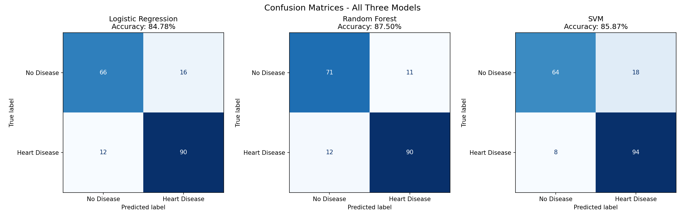
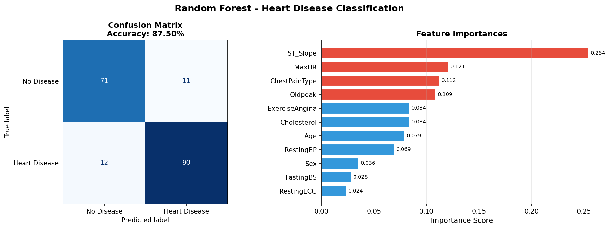
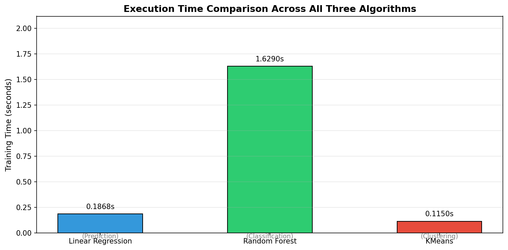
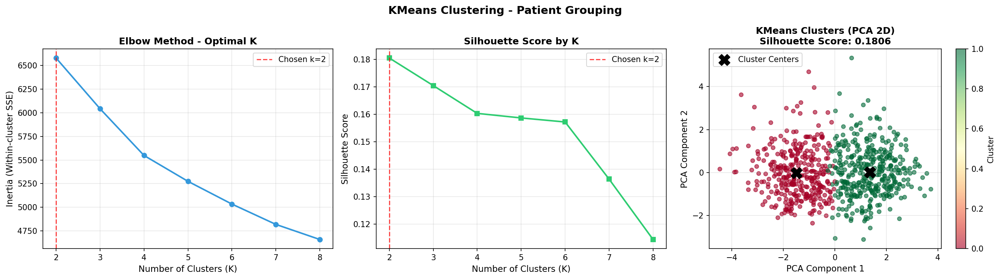
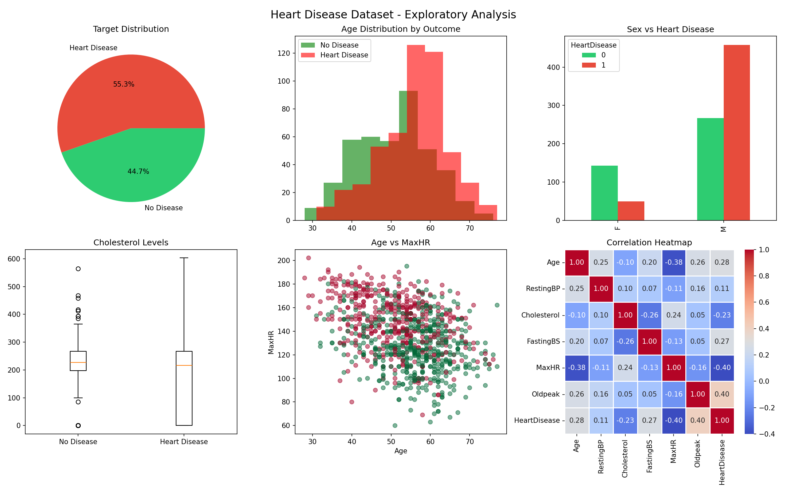

# Heart Disease Prediction

A machine learning project that predicts the presence of heart disease from patient clinical data, built in Python for my AI and Machine Learning course. It covers exploratory data analysis, three classifiers, a regression task, patient clustering, and a comparison of the algorithms.

## Dataset
`heart.csv` has **918 patient records and 12 columns** (11 features plus the target `HeartDisease`):

| Type | Features |
|---|---|
| Numeric | Age, RestingBP, Cholesterol, FastingBS, MaxHR, Oldpeak |
| Categorical | Sex, ChestPainType, RestingECG, ExerciseAngina, ST_Slope |

- **Target balance:** 508 patients with heart disease (55.3%) and 410 without (44.7%).
- **Missing values:** none, but 172 patients have a cholesterol value of 0, which is not physiologically possible. These were replaced with the median (223.0).
- **Source:** [Heart Failure Prediction Dataset (Kaggle)](https://www.kaggle.com/datasets/fedesoriano/heart-failure-prediction)

## Preprocessing
- Label encoding of the categorical columns
- Median replacement of the zero cholesterol entries
- Stratified 80/20 train/test split (`random_state=42`): **734 training and 184 test patients**
- Standard scaling for Logistic Regression and SVM (Random Forest uses unscaled features)

## What this project does
- **Exploratory data analysis:** target balance, age and sex distributions, cholesterol by outcome, feature correlations
- **Classification:** Logistic Regression, Random Forest and SVM (RBF kernel) predicting heart disease
- **Regression:** Linear Regression predicting maximum heart rate (MaxHR)
- **Clustering:** K-means grouping patients by clinical similarity
- **Loss and optimization:** the maths behind each algorithm, plus a learning curve for the random forest
- **Prediction demo:** the trained models applied to 5 unseen patients

## Results

### Classification (test set, 184 patients)
| Model | Accuracy | Precision (disease) | Recall (disease) | F1 (disease) |
|---|---|---|---|---|
| Logistic Regression | 84.78% | 0.85 | 0.88 | 0.87 |
| **Random Forest** | **87.50%** | **0.89** | 0.88 | **0.89** |
| SVM (RBF) | 85.87% | 0.84 | **0.92** | 0.88 |

Random Forest has the best accuracy and precision. SVM catches the most heart disease cases (recall 0.92; 8 missed, against 12 for the other two models), at the cost of more false alarms.

| Model | Correct "No Disease" | False alarms | Missed disease | Correct "Disease" |
|---|---|---|---|---|
| Logistic Regression | 66 | 16 | 12 | 90 |
| Random Forest | 71 | 11 | 12 | 90 |
| SVM | 64 | 18 | 8 | 94 |



**Most important features (Random Forest):** ST_Slope (0.254), MaxHR (0.121), ChestPainType (0.112) and Oldpeak (0.109).



### Regression and clustering
| Algorithm | Task | Metric | Training time |
|---|---|---|---|
| Linear Regression | Predict MaxHR | R² = 0.2731 (RMSE 22.02 bpm, MAE 17.31 bpm) | 0.1868 s |
| Random Forest | Classification | Accuracy = 0.8750 | 1.6290 s |
| K-means (k = 2) | Clustering | Silhouette = 0.1806 | 0.1150 s |

Training times come from a single run and will vary by machine.



K-means split the training patients into two groups (350 and 384 patients). The silhouette score is low, so the clusters overlap and are not sharply separated.



### Exploratory analysis


## Project structure
```
heart_ml_project.ipynb   main notebook (EDA, models, comparison)
Machine.ipynb            earlier course notebook
heart.csv                dataset
figures/                 generated plots
```

## How to run
```
git clone https://github.com/YOUR-USERNAME/heart-disease-prediction.git
cd heart-disease-prediction
pip install pandas numpy matplotlib seaborn scikit-learn jupyter
jupyter notebook heart_ml_project.ipynb
```

## Limitations
- Evaluation uses a single train/test split. Results on 184 patients can shift with a different split, so cross-validation is needed for reliable numbers.
- The random forest learning curve shows training accuracy of 1.00 against about 0.85 validation accuracy, which means it overfits. Tuning (tree depth, minimum samples per leaf) is still to do.
- Categorical features were label-encoded. This imposes an artificial order on unordered categories such as ChestPainType, which makes the Logistic Regression coefficients hard to interpret. One-hot encoding would be more appropriate.
- The median used to replace zero cholesterol values was computed on the full dataset before splitting, which leaks a small amount of test information into training.
- Linear Regression explains only 27% of the variance in MaxHR, and K-means clusters overlap heavily.
- Trained on a single small dataset and not validated externally. This is a learning project, not a clinical tool.

## Next steps
- Add stratified k-fold cross-validation and ROC-AUC / PR-AUC metrics
- Build a leak-free scikit-learn `Pipeline` with one-hot encoding
- Tune hyperparameters and calibrate probabilities
- Add explainability with SHAP and permutation importance
- Validate on a second heart disease dataset